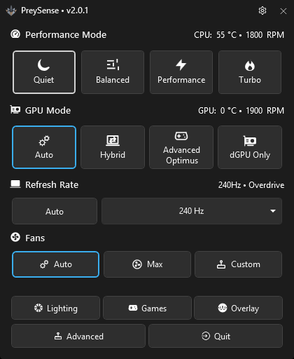
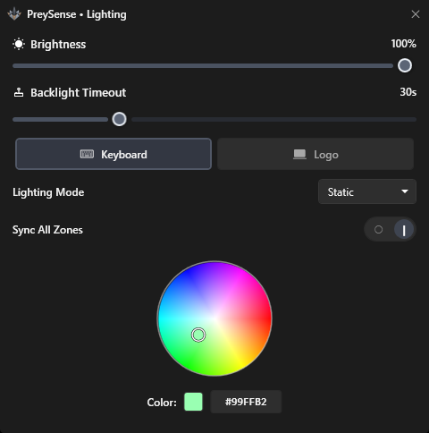
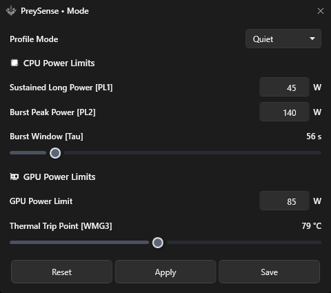
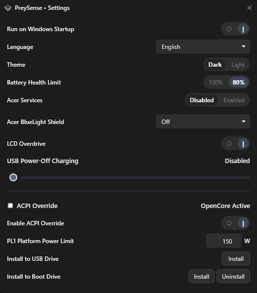
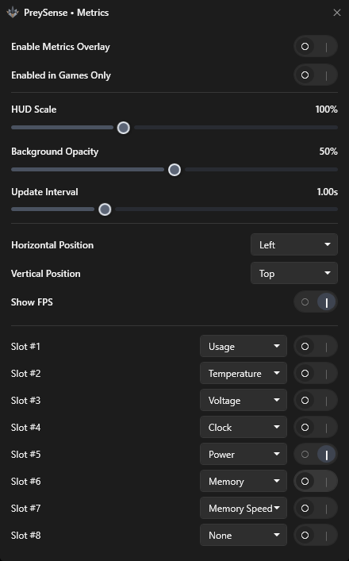
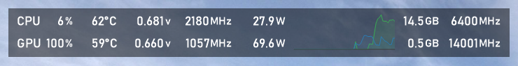

#  PreySense

PreySense is a Windows utility for Acer Predator laptops. It replaces the official Predator Sense suite.

Developed and verified on the **Acer Predator Helios Neo 16S (`PHN16S-71-98RF`)**. Other Predator models may work; that is not guaranteed.

<p align="center">
  
  <br>
  <em>Main dashboard — performance, GPU, display, fan, and quick-access controls</em>
</p>

## Screenshots

| Keyboard and logo lighting | Per-mode power limits |
| :---: | :---: |
|  |  |

| Platform and OpenCore settings | Metrics overlay configuration |
| :---: | :---: |
|  |  |

<p align="center">
  
  <br>
  <em>Real-time hardware telemetry overlay</em>
</p>

## Contents

- [Features](#features)
- [Screenshots](#screenshots)
- [Requirements](#requirements)
- [Install and run](#install-and-run)
- [OpenCore](#opencore)
- [Building](#building)
- [Disclaimer](#disclaimer)

## Features

- **Performance modes** — Quiet (AC) / Eco (battery), Balanced, Performance, and Turbo, including the chassis Mode / Turbo key
- **Per-mode CPU and GPU power** — watt and thermal limits for each performance mode (requires OpenCore)
- **GPU display switching** — Optimus, Automatic, Advanced Optimus (no reboot), and dGPU Only (reboot)
- **Fans** — Auto, Max, or custom CPU/GPU speed, independent of the performance mode
- **Lighting** — four-zone keyboard and cover logo, hardware effects, custom animations (Rainbow Cycle, CPU Heatmap, Battery Fuel Gauge, Police Strobe, Fire Ember, Matrix Cascade, Cylon Scanner, Aurora Drift, Ocean Tide, Heartbeat, Lightning Storm, Starlight, Ice Crystal), optional logo sync
- **Game profiles** — apply a mode and power limits when a watched game starts; restore when it exits
- **Hardware overlay** — always-on-top CPU/GPU stats, optional graphs, and FPS
- **Display** — refresh rate, LCD overdrive, BlueLight Shield
- **Battery** — 80% charge limit and USB power-off charging cutoff
- **Startup and tray** — run on Windows startup, hide to the tray, Predator key to show or hide
- **OpenCore installer** — optional boot-drive or USB install from Settings for live power limits

## Requirements

- Windows 10 or 11 x64
- Acer Predator laptop
- [Microsoft .NET 10 Windows Desktop Runtime x64](https://dotnet.microsoft.com/download/dotnet/10.0)
- Run **as administrator**

## Install and run

1. Download the latest `PreySense.exe`.
2. Run it as administrator. A second launch brings the existing instance to the front.
3. Close official Predator Sense if it is running.
4. For CPU/GPU watt limits, install OpenCore from **Settings** and set PreySense first in the BIOS boot order.

Closing the window hides to the tray. **Quit** exits.

## OpenCore

OpenCore is optional. Without it, modes, fans, lighting, GPU switching, and the overlay still work. CPU/GPU watt limits and game auto-apply stay locked until OpenCore is loaded and ACPI Override is turned on in Settings.

**Install to Boot Drive** (from Settings):

1. PreySense deletes any existing `PREYSENSE` partition, then creates a new small hidden EFI partition with that label.
2. The partition has no Windows drive letter. BIOS can still browse it.
3. Enroll all three files. Repeat the trusted-file step for each one:
   1. Open BIOS → Security. Set a supervisor password if asked, then reboot.
   2. Open BIOS → Security → **Select an UEFI file as trusted for executing**.
      `PREYSENSE` → `EFI` → `BOOT` → `BOOTX64.EFI`
   3. Repeat: `PREYSENSE` → `EFI` → `OC` → `OpenCore.efi`
   4. Repeat: `PREYSENSE` → `EFI` → `OC` → `Drivers` → `OpenRuntime.efi`
   5. Save and exit from BIOS. After restart, open BIOS again.
   6. Boot → put BOOTX64 first in the boot order. Save and exit.

USB install is the same files on a FAT32 stick. Restart, press F12, and select the USB drive. Unplug it to boot stock Windows.

## Building

Prerequisite: [.NET 10 SDK](https://dotnet.microsoft.com/download/dotnet/10.0).

```powershell
powershell -NoProfile -ExecutionPolicy Bypass -File .github\publish.ps1
```

The output is `dist\PreySense.exe`.

## Disclaimer

PreySense changes fans, power limits, and firmware-visible system state. Wrong settings can cause throttling, shutdowns, or instability. Use at your own risk.
